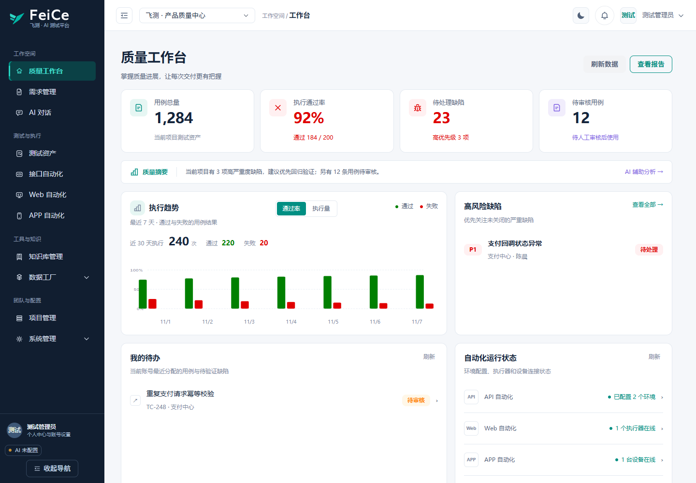

# FeiCe 飞测前端

Vue 3 + TypeScript + Vite 构建的测试管理与自动化协作前端。功能、服务架构和完整部署见[项目 README](../README.md)。

## 当前界面

当前采用深蓝导航、浅色工作区、青绿主操作和紫色 AI 标识。统一登录、注册、后台导航、卡片、表单、表格、弹窗和自动化工作区。支持深色主题、桌面折叠导航、手机抽屉导航及内容区响应式布局。

测试资产、接口、Web 和 APP 在主导航中使用单一模块入口，子页面通过页内标签切换。Web 的 9 个子页、APP 的 12 个子页及测试资产共享一致的导航结构。知识库列表/详情、权限工具栏、审核控件和 Trace 详情也使用相同的紧凑布局；窄屏表格允许横向滚动，操作列不会遮挡名称。

整站精修进一步合并模块与子页的重复标题，统一面板和控件尺度；手机模块标签提供“全部”入口，APP 指标采用双列排列。知识库提供创建引导，项目加载与服务检查使用独立状态；工作台的规则汇总标为“质量摘要”，执行趋势的通过率和执行量视角均采用红绿柱图。改造与验收见[整站精修记录](../docs/plans/2026-11-02-refined-workbench.md)。



截图来自当前代码与隔离演示接口，不代表真实项目数据。

## 技术栈

- Vue 3.5、TypeScript 5.8、Vite 6、Vue Router 4、Pinia 3
- Arco Design Vue、VueUse、Axios
- Monaco Editor、Marked、DOMPurify

## 启动与构建

建议使用 Node.js 20，与 Docker 构建环境一致。在本目录执行：

```bash
npm ci
npm run dev -- --host 127.0.0.1 --port 5173
```

打开 http://127.0.0.1:5173/login 。前端需要独立运行的 Django 后端；APP 自动化还需要 FastAPI 服务。

```bash
npm run build
npm run preview -- --host 127.0.0.1 --port 5176
```

`build` 包含 Vue / TypeScript 类型检查，产物输出到 `dist/`。`preview` 继承当前配置中的代理，联调时仍需启动相应后端；正式部署使用 Nginx / Docker。

## 开发代理

`vite.config.ts` 读取 Vite 环境文件（例如 `.env.local`）及进程环境变量，进程变量优先。开发与生产预览均生效；修改代理配置后需重启服务。

| 变量 | 默认值 / 用途 |
| --- | --- |
| `VITE_PROXY_TARGET` | `http://localhost:8000`，代理 `/api/` 与 `/media/` |
| `VITE_APP_AUTOMATION_PROXY_TARGET` | `http://localhost:8010`，代理 `/api/app-automation/` 并去掉该前缀 |
| `VITE_WS_PROXY_TARGET` | 由主 API 目标转换为 `ws` / `wss`，代理 `/ws/` |
| `VITE_DEV_HOST` | `127.0.0.1`，开发服务监听主机 |
| `VITE_ALLOWED_HOSTS` | 默认使用开发主机；多个值以逗号分隔 |

PowerShell 示例：

```powershell
$env:VITE_PROXY_TARGET = "http://127.0.0.1:8000"
$env:VITE_APP_AUTOMATION_PROXY_TARGET = "http://127.0.0.1:8010"
npm run dev -- --port 5173
```

生产部署由 `nginx.conf` 处理 SPA 路由、API、WebSocket、媒体和 APP 服务代理。完整服务部署见[根 README](../README.md#快速开始)。

## 目录与主题维护

| 路径 | 职责 |
| --- | --- |
| `src/router/` | 登录、注册及受保护业务路由 |
| `src/layouts/` | 主导航、顶栏与工作区布局 |
| `src/views/` | 首页、项目、测试管理与系统管理页面 |
| `src/features/` | AI、知识库、需求、API / UI / APP 自动化等功能模块 |
| `src/components/` | 公共控件、认证界面、首页与用例组件 |
| `src/services/`、`src/store/` | 业务接口与 Pinia 状态 |
| `src/workspace-theme.css` | 工作区布局基础 |
| `src/styles/a2-workspace.css` | 语义主题 token、公共控件和响应式基础 |
| `src/styles/feice-workbench.css` | 深蓝、青绿与紫色的统一视觉规范及重点页面布局 |
| `src/styles/workbench-completion.css` | 剩余模块、知识详情、权限工具栏、Trace 和小屏表格的布局规范 |
| `src/styles/workspace-layout.css` | 业务目录、全宽工作区、抽屉和编排面板布局 |
| `src/components/workspace/` | 页面标题、目录节点菜单及可保留状态的工作区组件 |
| `src/components/auth/auth-workspace.css` | 分栏登录、注册与认证辅助入口样式 |
| `src/utils/qualityStatus.ts` | 通过率、覆盖率、颜色与百分比转换 |
| `public/feice-*.svg` | FeiCe 品牌矢量源文件 |
| `scripts/` | 布局、交互、认证、质量指标检查与品牌导出 |

主要操作青绿 `#008F83`、AI 紫 `#7C5CE2`、通过绿 `#008000`、风险红 `#E00000`。通过率只有原始值等于 100% 才为绿色；覆盖率 ≥80% 为绿色。缺失覆盖率显示空状态，不根据不同类型资产数量推算。Inter 字体本地托管于 `public/fonts/`，授权见同目录 SIL OFL 文件。

测试资产在 ≥1280px 显示详情审核栏，小屏改用抽屉。接口工作区复用现有保存和执行服务；AI 断言调用现有用例生成任务获取草稿，人工确认并保存后才进入当前接口，不调用批量落库接口。工作台风险摘要基于统计规则，AI 分析入口进入现有对话模块；不预置设计稿中的示例业务数据。

## 浏览器验证

先启动前端，准备独立可用的 Playwright 包和浏览器。Playwright 不在生产依赖内；可运行 `npm install --no-save --package-lock=false playwright` 临时安装，或设置 `PLAYWRIGHT_MODULE` 指向已有包。

```powershell
$env:UI_BASE_URL = "http://127.0.0.1:5173"
$env:UI_BROWSER_CHANNEL = "msedge"
npm run test:layout
npm run test:layout:interactions
npm run test:auth
npm run test:dashboard
npm run test:quality
npm run test:workbench
npm run test:workbench:state
npm run test:workbench:completion
npm run test:workbench:navigation
node scripts/verify-a2-details.cjs
```

各脚本默认端口不同，请显式设置 `UI_BASE_URL`。使用 Playwright Chromium 时取消 `UI_BROWSER_CHANNEL` 并运行 `npx playwright install chromium`。检查使用隔离接口夹具，不向业务库写数据；输出位于被 Git 忽略的 `playwright-screenshots/`。

详见[脚本说明](./scripts/README-layout.md)和[深蓝青绿界面验收记录](../docs/plans/2026-11-02-navy-teal-verification.md)。

## 许可证

与仓库根目录一致，采用 [PolyForm Noncommercial 1.0.0](../LICENSE)，使用范围以许可证原文为准。
