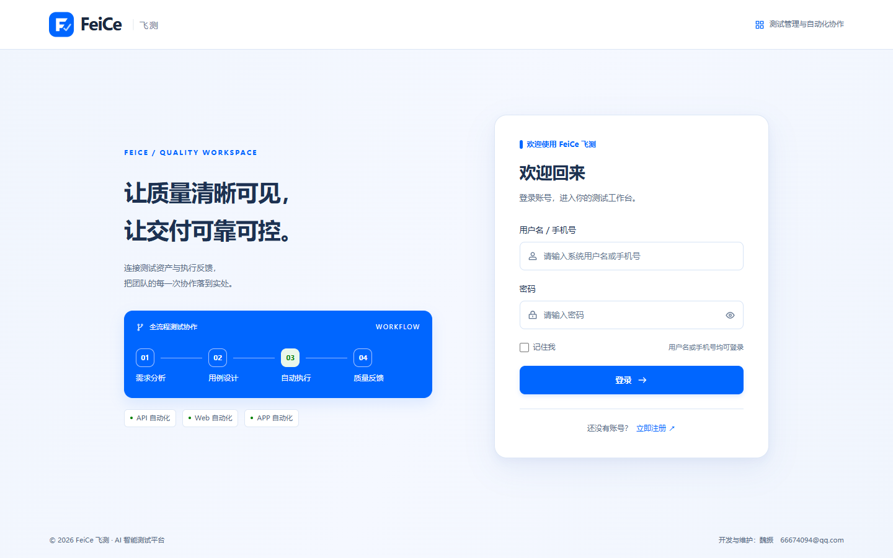
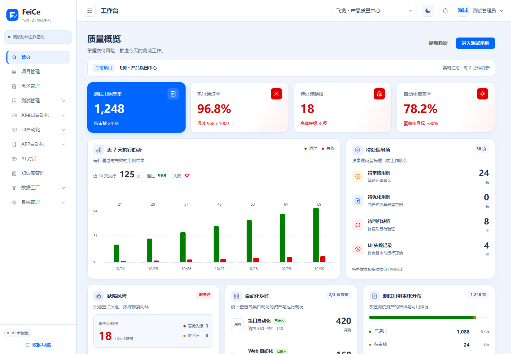
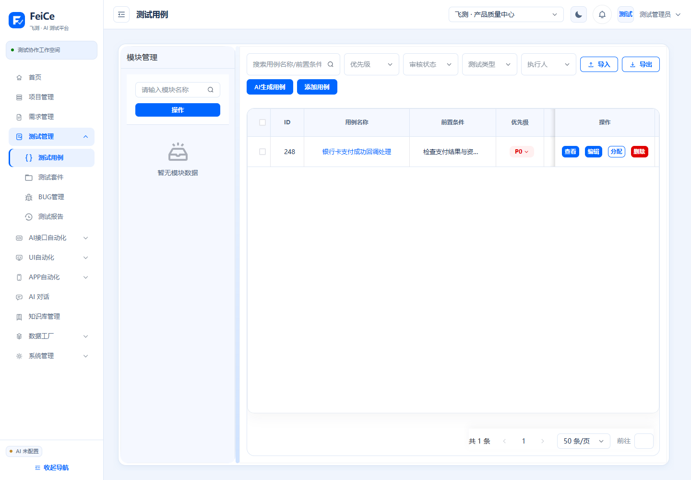
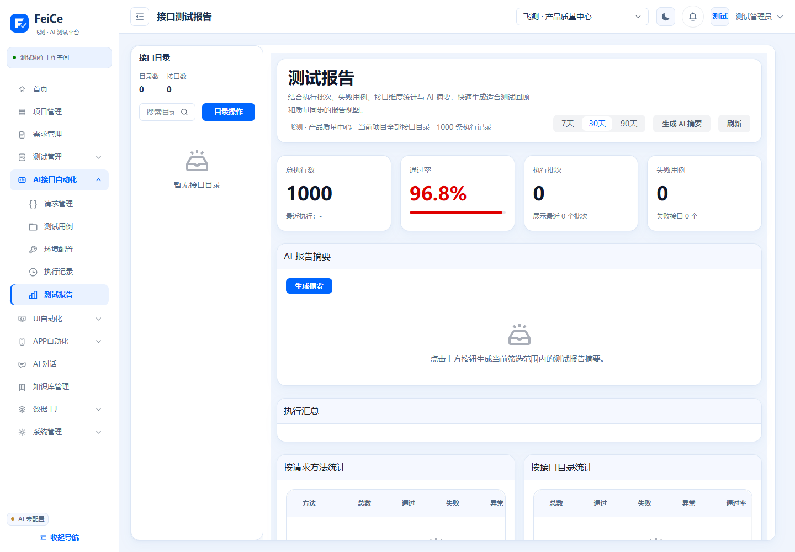
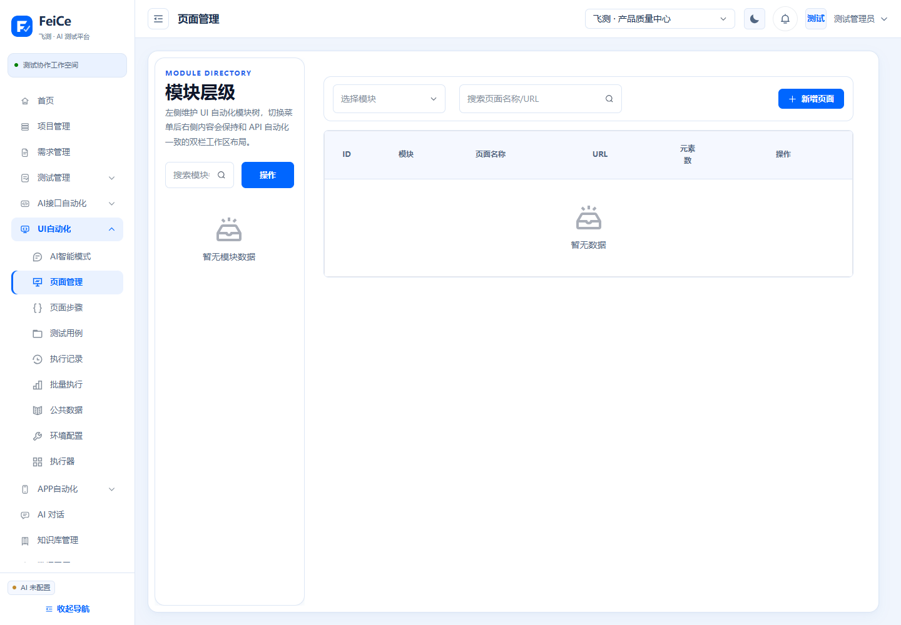
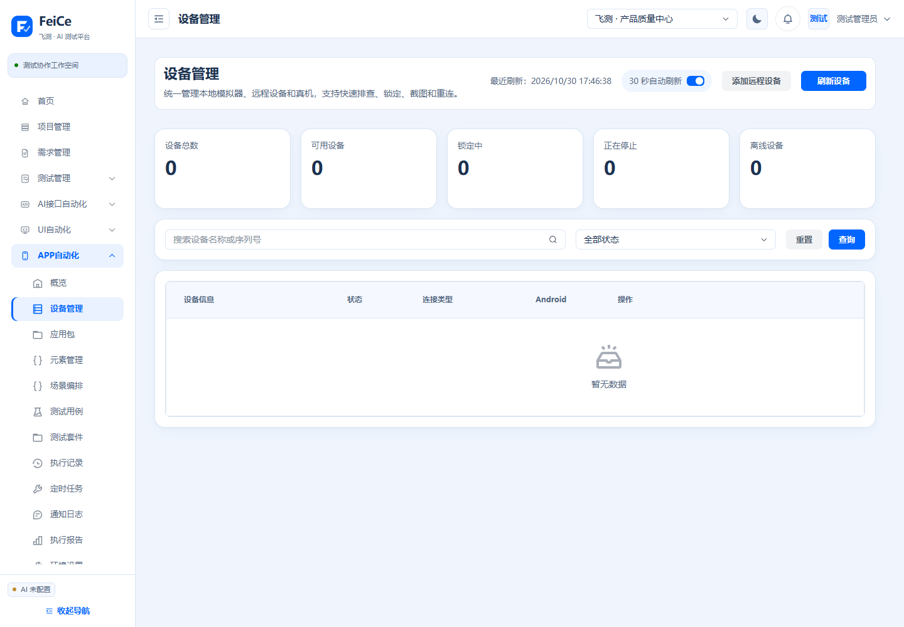
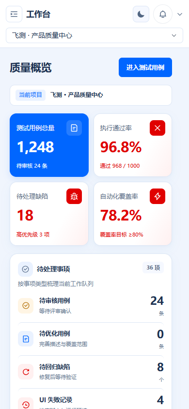
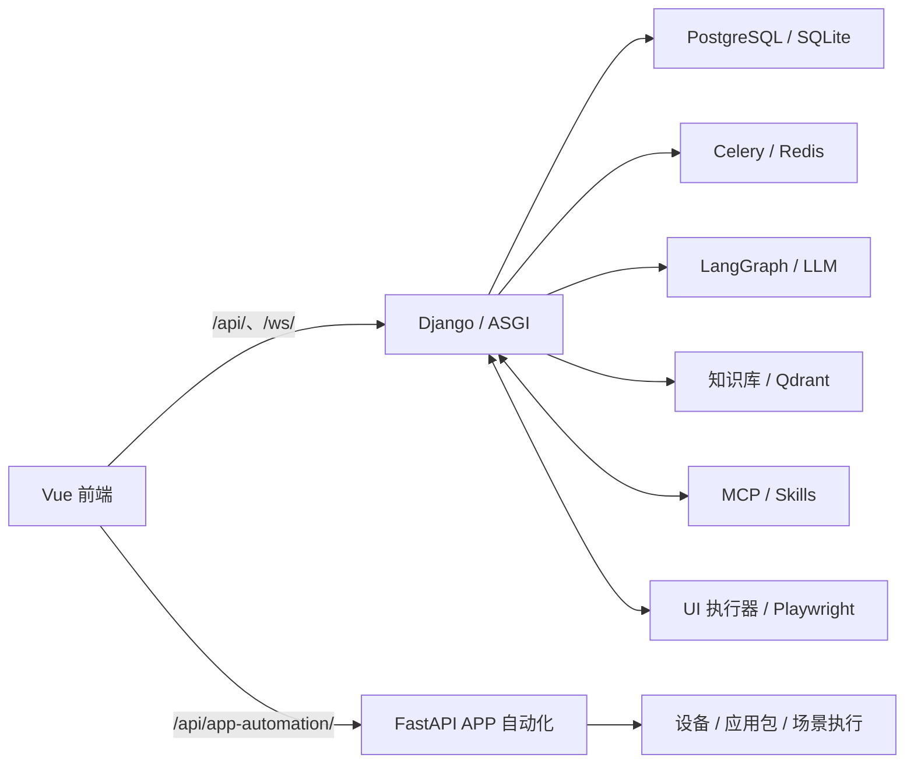

# FeiCe 飞测

面向测试团队的 AI 测试管理与自动化协作平台，连接需求评审、测试设计、用例资产、缺陷跟踪和 API / Web / APP 自动化执行。

[English](./README_EN.md) · [快速开始](#快速开始) · [界面预览](#界面预览) · [开发与验证](#开发与验证) · [项目文档](./docs/index.md)

> 产品品牌统一为 **FeiCe 飞测**。`FlyTest_*` 目录、部分环境变量和服务名保留历史名称，与当前代码兼容。

## 核心能力

| 模块 | 当前能力 |
| --- | --- |
| 质量工作台 | 用例总量、执行通过率、待处理缺陷、执行趋势、待处理事项、缺陷风险、自动化矩阵、审核分布与 Token 使用概况 |
| 需求管理 | 文档上传、拆分、评审、专项分析及报告查看 |
| AI 对话与配置 | LangGraph 对话、LLM 配置、提示词、工具审批、知识库与 Skills 协同 |
| 测试资产 | 用例、模块、套件、BUG、执行历史、报告、用例模板与数据工厂 |
| API 自动化 | 接口目录、请求管理、测试用例、环境配置、执行记录与测试报告 |
| Web / UI 自动化 | 页面、页面步骤、用例、AI 智能模式、执行记录、批量执行、公共数据、环境与执行器 |
| APP 自动化 | 设备、应用包、元素、场景编排、用例、套件、执行记录、定时任务、通知日志与报告 |
| 团队与扩展 | 项目、用户、组织、权限、操作日志、站内通知、API Key、远程 MCP 与 Skills 管理 |

AI、向量检索和设备执行能力需要配置相应模型、服务或设备；仅启动前端不会自动获得这些能力。

## 界面预览

当前前端采用 A2 明亮工作台方案：统一 FeiCe 品牌、蓝色主操作、圆角卡片、紧凑筛选区和表格，以及适配桌面、平板和手机的导航与内容布局。支持深色主题。

以下为当前代码的浏览器截图。业务数据来自隔离的演示接口夹具，包含统计字段的展示示例，不代表真实项目数据或所有后端字段均已接入。

| 登录页 | 质量工作台 |
| --- | --- |
|  |  |

| 测试用例 | API 测试报告 |
| --- | --- |
|  |  |

| Web / UI 自动化 | APP 自动化设备管理 |
| --- | --- |
|  |  |

<details>
<summary>查看手机端布局</summary>



</details>

### 质量指标配色

- 主操作：蓝色 `#0066FF`；通过：绿色 `#008000`；风险：红色 `#E00000`。
- 执行通过率：原始值恰好为 **100%** 时绿色，其余有效通过率均为红色。
- 待处理缺陷：红色；自动化覆盖率：**≥80%** 绿色、低于 80% 红色。
- 执行趋势仅使用绿色和红色柱子表示通过与失败。
- 无有效数据时显示占位或空状态。当前 Django 项目统计未提供自动化覆盖率字段时，首页显示“暂无覆盖率数据”，不根据不同资产数量推算覆盖率。

## 技术与仓库结构

| 目录 | 职责与技术 |
| --- | --- |
| `FlyTest_Vue/` | Vue 3.5、TypeScript 5.8、Vite 6、Pinia、Arco Design Vue 前端 |
| `FlyTest_Django/` | Django 5.2、DRF、SimpleJWT、Channels / ASGI，承载核心业务 API |
| `FlyTest_FastAPI_AppAutomation/` | 独立 FastAPI APP 自动化服务 |
| `FlyTest_Actuator/` | 通过 WebSocket 接入的 Playwright UI 执行器 |
| `FlyTest_MCP/` | MCP 测试工具服务 |
| `FlyTest_Skills/` | 内置 Skills |
| `docs/` | 功能、部署、开发和验收文档 |
| `deploy/`、`deploy-scripts/` | 部署配置与脚本 |

AI 与知识检索使用 LangChain / LangGraph、Qdrant；异步任务使用 Celery / Redis；主后端支持 PostgreSQL 与 SQLite。



## 快速开始

### 方式一：使用当前源码构建 Docker 服务

准备 Git、Docker 与 Docker Compose。根目录 `.env` 用于 Compose 变量替换，Django 本地开发使用另一份 `FlyTest_Django/.env`。

```bash
git clone https://github.com/flytestai/flytest.git
cd flytest
cp .env.example .env
# 编辑 .env，设置密钥、管理员密码与数据库配置
docker compose -f docker-compose.local.yml up -d --build
```

Windows PowerShell 可用 `Copy-Item ".env.example" ".env"` 替代 `cp`。

`docker-compose.local.yml` 从当前源码构建项目服务。默认 `docker-compose.yml` 混合使用预构建镜像和本地构建，预构建镜像不一定包含 `main` 最新改动；验证当前代码请使用上面的源码构建方式。

| 服务 | 默认本机入口 |
| --- | --- |
| 前端 | http://localhost:8913 |
| Django API | http://localhost:8912/api/ |
| Redis | `localhost:8911` |
| FeiCe MCP | `localhost:8914` |
| MS MCP（按需配置） | `localhost:8915` |
| Playwright MCP | `localhost:8916` |
| Qdrant | `localhost:8918` |
| PostgreSQL | `localhost:8919` |

APP 自动化在容器网络使用 `8010`，通过前端 `/api/app-automation/` 代理访问，默认没有单独暴露宿主机端口。

管理员由容器启动流程按 `DJANGO_ADMIN_USERNAME` / `DJANGO_ADMIN_PASSWORD` 创建。复制示例文件后以 `.env` 中填写的值为准；未设置变量时 Compose 回退为 `admin` / `admin123456`。

### 方式二：本地开发

建议使用 Python 3.11 和 Node.js 20，与仓库 Docker 构建环境保持一致。以下命令以仓库根目录为起点，各服务使用独立终端；Python 服务建议使用独立虚拟环境。

#### 1. Django 主后端

```powershell
cd "FlyTest_Django"
python -m venv .venv
.\.venv\Scripts\Activate.ps1
Copy-Item ".env.example" ".env"
python -m pip install -r requirements.txt
```

Linux / macOS 使用 `source .venv/bin/activate` 激活环境，使用 `cp .env.example .env` 复制配置。

编辑 `FlyTest_Django/.env`：简单本地体验可设置 `DATABASE_TYPE=sqlite`；默认 `postgres` 则需要可用 PostgreSQL，且主机、端口、库名和凭据匹配。随后初始化数据库和管理员：

```bash
python manage.py migrate
python manage.py createsuperuser
python -m uvicorn flytest_django.asgi:application --host 127.0.0.1 --port 8000 --reload
```

使用 ASGI 服务以支持 WebSocket。直接启动本地后端不会执行容器的管理员初始化流程，需要上面的 `createsuperuser`。

#### 2. Vue 前端

```bash
cd FlyTest_Vue
npm ci
npm run dev -- --host 127.0.0.1 --port 5173
```

打开 http://127.0.0.1:5173/login 。Vite 默认代理 `/api/`、`/media/` 到 Django `8000`，`/ws/` 到其 WebSocket 服务，`/api/app-automation/` 到 FastAPI `8010`。

代理目标可通过进程环境变量 `VITE_PROXY_TARGET`、`VITE_WS_PROXY_TARGET`、`VITE_APP_AUTOMATION_PROXY_TARGET` 覆盖。例如 PowerShell 在启动前设置 `$env:VITE_PROXY_TARGET = "http://127.0.0.1:8000"`。

#### 3. 按功能启动配套服务

- **异步任务与知识库**：需要 Redis、Celery worker，知识库向量检索还需要 Qdrant 及相应模型配置。可在仓库根目录运行 `docker compose -f docker-compose.local.yml up -d redis qdrant`，并将 Django 的 Redis 地址设为 `redis://127.0.0.1:8911/0`、Qdrant 地址设为 `http://127.0.0.1:8918`。
- **WebSocket 多进程通信**：按需设置 `CHANNEL_REDIS_URL=redis://127.0.0.1:8911/1`；单进程本地可不配置。
- **APP 自动化**：独立安装与启动，JWT 密钥必须与 Django 一致。设备连接、驱动与 OCR 等依赖见 [APP 服务说明](./FlyTest_FastAPI_AppAutomation/README.md)。
- **UI 执行器与 MCP**：见 [执行器说明](./FlyTest_Actuator/README.md) 和 [MCP 服务说明](./FlyTest_MCP/README.md)，按实际后端地址与 API Key 配置。

在 Django 虚拟环境中运行 worker；需要定时任务时另开终端启动 beat：

```bash
celery -A flytest_django worker -l info -Q celery,ui_automation
celery -A flytest_django beat -l info
```

Windows 本地调试 worker 可追加 `--pool=solo`。若自定义 `UI_AUTOMATION_CELERY_QUEUE`，worker 的 `-Q` 应包含对应队列。

APP 服务启动示例（先在该目录创建并激活独立虚拟环境；设置 `APP_AUTOMATION_JWT_SECRET` 为 Django 实际使用的 `DJANGO_SECRET_KEY`）：

```bash
cd FlyTest_FastAPI_AppAutomation
python -m pip install -r requirements.txt
python -m uvicorn app.main:app --host 127.0.0.1 --port 8010 --reload
```

## 开发与验证

在 `FlyTest_Vue/` 中：

```bash
npm run build
npm run preview -- --host 127.0.0.1 --port 5176
```

`build` 执行 Vue / TypeScript 类型检查并生成 `dist/`。Vite 预览继承当前配置中的代理，联调时仍需启动相应后端；正式部署使用 Nginx / Docker。

仓库提供布局、交互、登录、首页与质量指标检查脚本。先启动前端，再在 PowerShell 设置统一测试地址（各脚本默认端口不同）：

```powershell
$env:UI_BASE_URL = "http://127.0.0.1:5173"
$env:UI_BROWSER_CHANNEL = "msedge"
npm run test:layout
npm run test:layout:interactions
npm run test:auth
npm run test:dashboard
npm run test:quality
node scripts/verify-a2-details.cjs
```

脚本需要额外可用的 Playwright 包和浏览器；它们不属于生产依赖。可临时运行 `npm install --no-save --package-lock=false playwright`，或通过 `PLAYWRIGHT_MODULE` 指向已有包。使用 Edge 时保留上述浏览器变量；使用 Playwright Chromium 时取消该变量并运行 `npx playwright install chromium`。

这些检查在独立浏览器中拦截接口，不向业务库写入测试数据。截图与报告输出到被 Git 忽略的 `playwright-screenshots/`。布局夹具不能替代真实权限、模型、设备和外部服务的业务验收。

最新 A2 验证记录涵盖 46 个主要入口在 1440 / 1024 / 390px 下的 138 项布局检查，以及 320px、弹窗、登录注册、质量阈值和交互专项检查，详见 [验收记录](./docs/plans/2026-10-30-feice-a2-verification.md)。

## 文档入口

- [项目文档首页](./docs/index.md) · [快速开始](./docs/QUICK_START.md)
- [前端说明](./FlyTest_Vue/README.md) · [布局与浏览器验证](./FlyTest_Vue/scripts/README-layout.md)
- [Django 后端](./FlyTest_Django/README.md) · [APP 自动化](./FlyTest_FastAPI_AppAutomation/README.md)
- [UI 执行器](./FlyTest_Actuator/README.md) · [MCP 服务](./FlyTest_MCP/README.md)
- [GitHub / Docker 部署](./docs/github-docker-deployment.md) · [UI AI 队列](./docs/UI_AI_QUEUE.md)
- [A2 前端实施记录](./docs/plans/2026-10-30-feice-a2-frontend.md) · [A2 验收记录](./docs/plans/2026-10-30-feice-a2-verification.md)

## 许可证与部署配置

本项目采用 [PolyForm Noncommercial 1.0.0](./LICENSE)，使用与分发范围以许可证原文为准。

对外部署前，请修改示例密钥、管理员密码与 API Key，核对 HTTPS、Cookie、允许的主机和跨域配置。Compose 中存在直接指定的开发配置，不能仅通过修改根 `.env` 假定所有生产配置均已生效；请核对实际 Compose 配置及部署文档。
