# FeiCe 飞测

An AI-assisted testing platform for QA teams, connecting requirement reviews, test design, test assets, defect tracking, and API / Web / APP automation.

[中文](./README.md) · [Quick start](#quick-start) · [Screenshots](#screenshots) · [Development and verification](#development-and-verification)

> The product brand is **FeiCe**. Historical `FlyTest_*` directory names, service names, and some environment variables remain for compatibility.

## Capabilities

| Area | Current scope |
| --- | --- |
| Quality workspace | Test asset totals, pass rate, pending defects, execution trends, backlog, defect risks, automation matrix, review distribution, and token usage |
| Requirements | Document upload, splitting, reviews, specialized analysis, and reports |
| AI and knowledge | LangGraph conversations, LLM configuration, prompts, tool approvals, knowledge retrieval, and Skills |
| Test assets | Cases, modules, suites, bugs, execution history, reports, templates, and data factory |
| API automation | Collections, requests, test cases, environments, execution records, and reports |
| Web / UI automation | Pages, steps, cases, AI mode, execution records, batch runs, shared data, environments, and actuators |
| APP automation | Devices, packages, elements, scene builder, cases, suites, execution records, scheduled tasks, notification logs, reports, and environment profiles |
| Collaboration and extensions | Projects, users, organizations, permissions, operation logs, notifications, API keys, remote MCP, and Skills management |

AI, vector retrieval, and device execution require the corresponding models, services, and devices to be configured.

## Latest workspace redesign (November 2026)

The current release uses navy navigation, light workspaces, teal actions (`#008F83`), and purple AI indicators (`#7C5CE2`). Requirement management, AI conversations, test assets, API automation, and all nine Web automation tabs now share consistent headers, filters, tables, detail panels, and responsive layouts.

APP automation now has twelve refined workspaces: overview, devices, packages, elements, scene builder, cases, suites, executions, scheduled tasks, notifications, reports, and environments. Knowledge management, the data factory, projects, and user management also have dedicated layouts.

- **Packages:** authenticated APK / AAB / IPA upload and download, installation history, and APK installation on available Android devices. AAB requires conversion; IPA requires an iOS driver. Installation history is not a complete device application inventory.
- **AI and suites:** element recognition, suite planning, and schedule drafts require configured models. Users adopt and save suggestions before use; draft generation does not execute tests. Suite execution supports sequential runs and parallel queues across multiple Android devices.
- **APP environments:** project profiles support CRUD, cloning, import/export, and checks. Android checks use ADB; service checks test TCP connectivity. Profile maintenance/enabling does not start devices or automatically replace task execution settings.
- **Knowledge:** project-scoped summaries, indexed chunks, source distribution, and search topics. Supported sources are files, text, and web links; automated Git/SVN synchronization is not implemented.
- **Data factory:** scenario filters, tool search, recent/favorite tools, history, tags, and API/UI references. Counts come from available service data rather than fixed design examples.
- **Projects and users:** member and asset summaries, recent project updates, user approval tabs, organization/role/account filters, read-only details, and explicit account toggles. Approval, account activation, and permission assignment are independent. Bulk user import is not available; absent login timestamps are shown as unavailable.

Rebuild the frontend and reload Django / APP services after updating. Existing processes do not acquire new endpoints automatically; the frontend reports unavailable capabilities. Persist and back up APP package files and project metadata alongside the database. See the [APP service guide](./FlyTest_FastAPI_AppAutomation/README.md).

## Screenshots

The workspace uses navy navigation, teal actions, rounded cards, compact filters and tables, responsive navigation, and dark theme support.

The first gallery shows the earlier navy/teal baseline; the new workspace gallery below shows this round of changes. All screenshots use isolated demonstration fixtures. Sample statistics are not production metrics or a claim that every field is supplied by the backend.

| Login | Quality workspace |
| --- | --- |
| 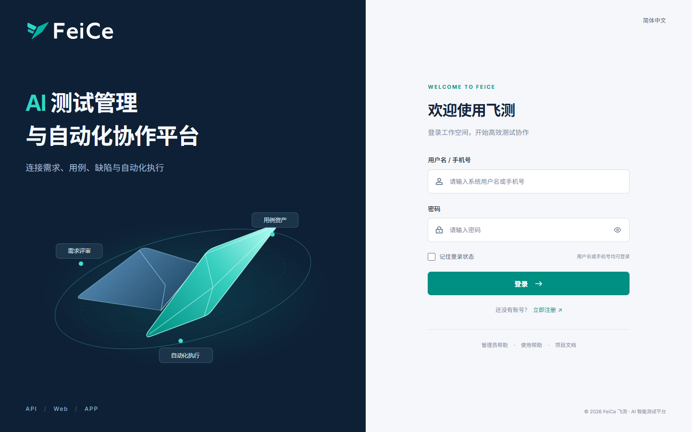 | 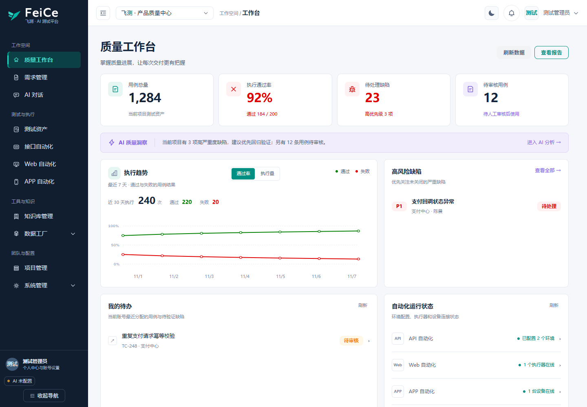 |

| Test cases | API request workspace |
| --- | --- |
| 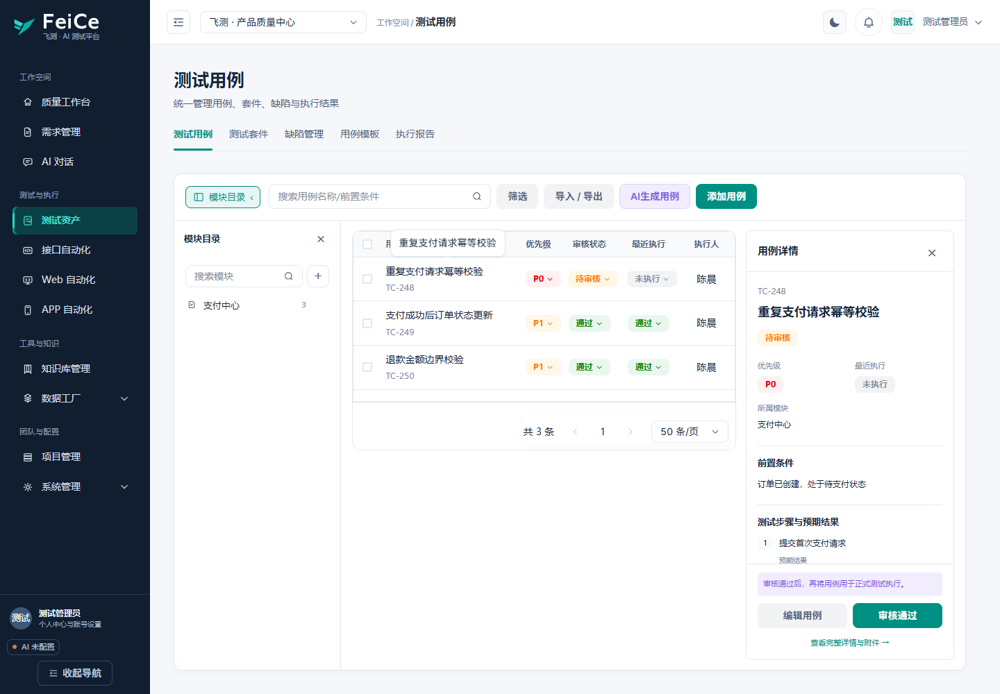 | 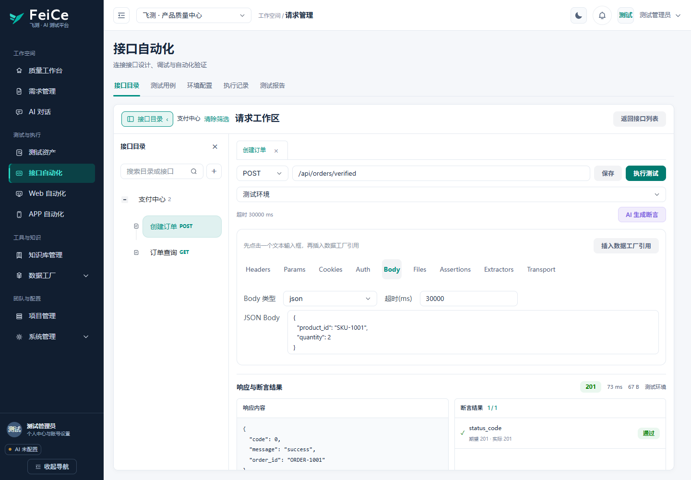 |

| Web / UI automation | APP device management |
| --- | --- |
| 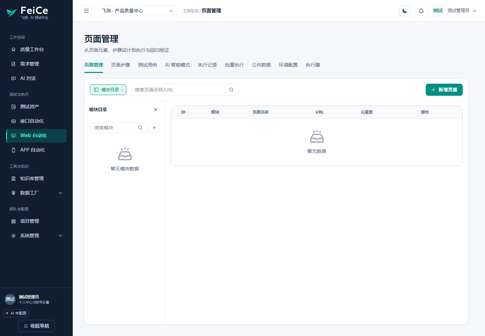 | 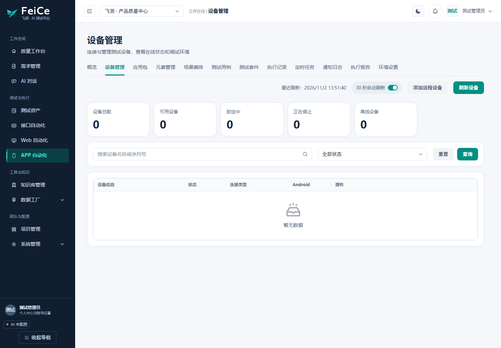 |

<details>
<summary>Mobile layout</summary>

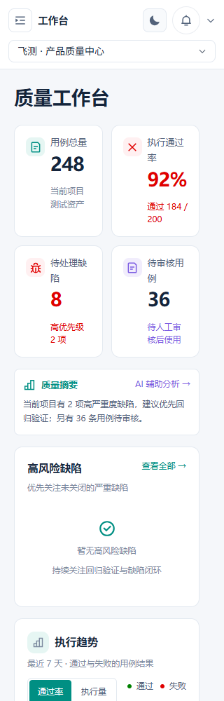

</details>

### New workspace previews

These screenshots also use isolated demonstration fixtures.

| Projects | Users |
| --- | --- |
| 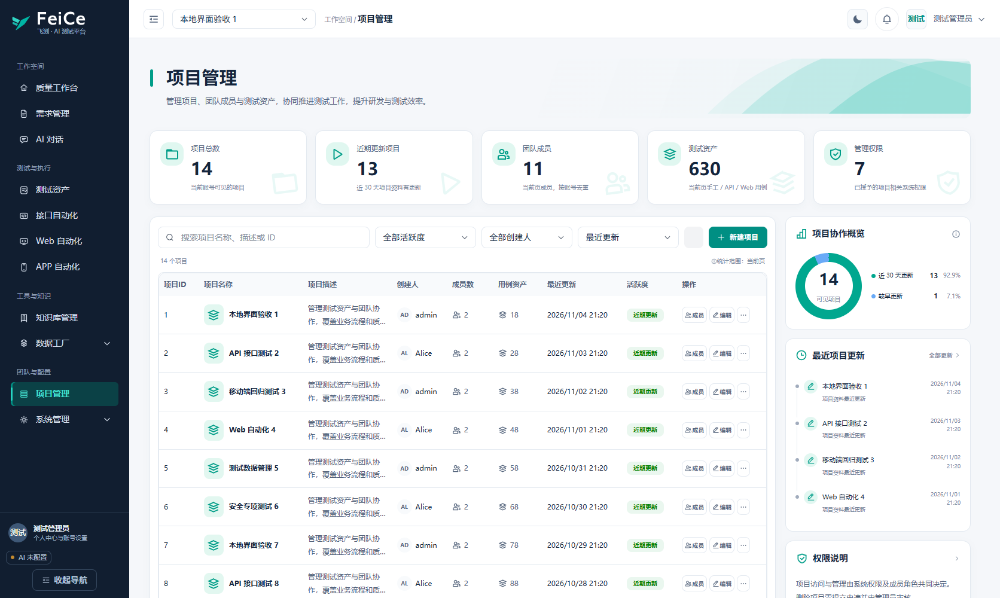 | 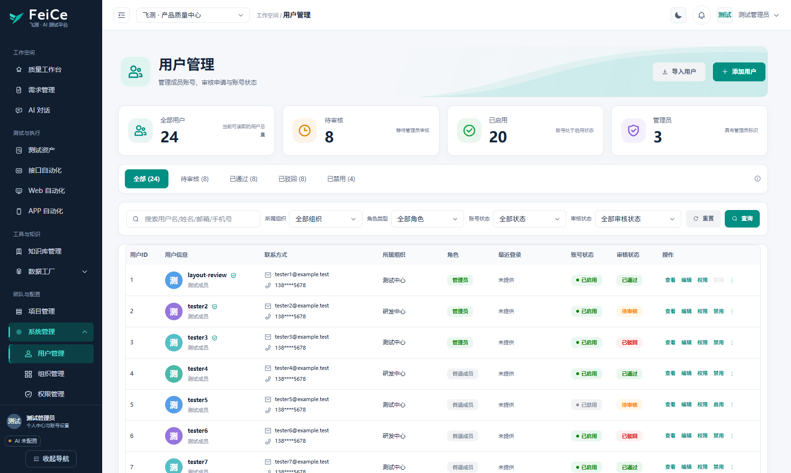 |

| Knowledge | Data factory |
| --- | --- |
| 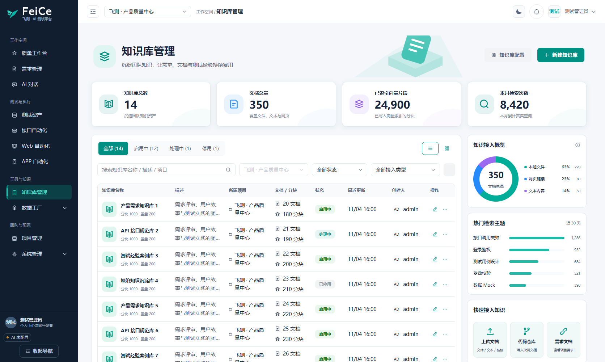 | 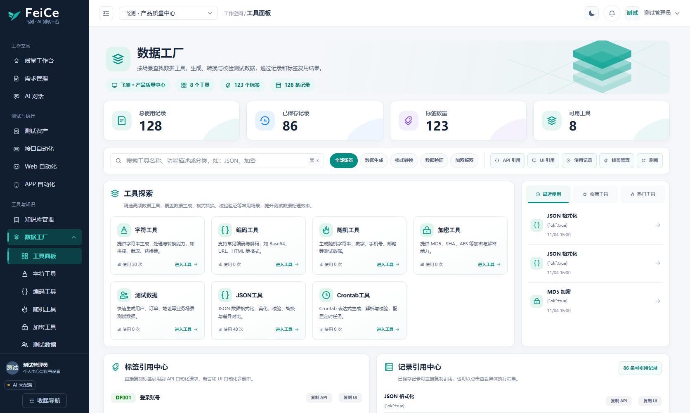 |

Quality colors are shared across the UI: action teal `#008F83`, pass green `#008000`, and risk red `#E00000`. A pass rate is green only when its unrounded value is exactly **100%**. Pending defects are red; coverage is green at **80% or above**, otherwise red. Execution bars use green for passed results and red for failures. Missing data uses an empty state. The dashboard displays unavailable coverage when Django statistics do not supply it, rather than estimating it from unrelated asset counts.

## Repository and stack

| Directory | Responsibility |
| --- | --- |
| `FlyTest_Vue/` | Vue 3.5, TypeScript 5.8, Vite 6, Pinia, Arco Design Vue |
| `FlyTest_Django/` | Django 5.2, DRF, SimpleJWT, Channels / ASGI, core business APIs |
| `FlyTest_FastAPI_AppAutomation/` | Independent FastAPI APP automation service |
| `FlyTest_Actuator/` | Playwright UI actuator connected through WebSocket |
| `FlyTest_MCP/` | MCP testing tools |
| `FlyTest_Skills/` | Bundled Skills |
| `docs/` | Product, deployment, development, and verification documentation |
| `deploy/`, `deploy-scripts/` | Deployment configuration and scripts |

Additional infrastructure includes LangChain / LangGraph, Qdrant, Celery / Redis, and PostgreSQL or SQLite for the main backend.

## Quick start

### Build the current source with Docker

Requirements: Git, Docker, and Docker Compose.

```bash
git clone https://github.com/flytestai/flytest.git
cd flytest
cp .env.example .env
# Edit .env: configure secrets, administrator credentials, and database settings
docker compose -f docker-compose.local.yml up -d --build
```

In PowerShell, use `Copy-Item ".env.example" ".env"` to copy the example. The root `.env` provides Compose substitutions; local Django development uses `FlyTest_Django/.env` separately.

Use `docker-compose.local.yml` to build project services from the checked-out source. The default `docker-compose.yml` mixes prebuilt images and local builds; its prebuilt images may not contain the latest changes on `main`.

| Service | Default host entry |
| --- | --- |
| Frontend | http://localhost:8913 |
| Django API | http://localhost:8912/api/ |
| Redis | `localhost:8911` |
| FeiCe MCP | `localhost:8914` |
| MS MCP, configured as needed | `localhost:8915` |
| Playwright MCP | `localhost:8916` |
| Qdrant | `localhost:8918` |
| PostgreSQL | `localhost:8919` |

APP automation runs on container port `8010`, accessed through the frontend `/api/app-automation/` proxy. No separate host port is exposed by default.

The container startup creates an administrator using `DJANGO_ADMIN_USERNAME` and `DJANGO_ADMIN_PASSWORD`. Use the values configured in `.env`; if variables are absent, Compose falls back to `admin` / `admin123456`.

### Local development

Python 3.11 and Node.js 20 match the repository's Docker build environment. Start each service in a separate terminal, from the repository root. Use separate Python virtual environments for independent services.

Django setup in PowerShell:

```powershell
cd "FlyTest_Django"
python -m venv .venv
.\.venv\Scripts\Activate.ps1
Copy-Item ".env.example" ".env"
python -m pip install -r requirements.txt
```

On Linux / macOS, activate with `source .venv/bin/activate` and copy with `cp .env.example .env`. Edit the Django `.env`: use `DATABASE_TYPE=sqlite` for a basic local setup, or configure a reachable PostgreSQL server for the default `postgres` mode.

```bash
python manage.py migrate
python manage.py createsuperuser
python -m uvicorn flytest_django.asgi:application --host 127.0.0.1 --port 8000 --reload
```

ASGI supports WebSocket connections. Local startup does not run the container administrator initialization; create the administrator explicitly.

Frontend, in another terminal:

```bash
cd FlyTest_Vue
npm ci
npm run dev -- --host 127.0.0.1 --port 5173
```

Open http://127.0.0.1:5173/login . Vite proxies `/api/` and `/media/` to Django on `8000`, `/ws/` to its WebSocket endpoint, and `/api/app-automation/` to FastAPI on `8010`. Override targets through process environment variables `VITE_PROXY_TARGET`, `VITE_WS_PROXY_TARGET`, and `VITE_APP_AUTOMATION_PROXY_TARGET`.

Optional services:

- Start Redis and Qdrant from the repository root with `docker compose -f docker-compose.local.yml up -d redis qdrant`. Set Django's broker/result backend to `redis://127.0.0.1:8911/0` and Qdrant to `http://127.0.0.1:8918`. Knowledge retrieval also requires model configuration.
- For shared WebSocket state across processes, set `CHANNEL_REDIS_URL=redis://127.0.0.1:8911/1`.
- Run `celery -A flytest_django worker -l info -Q celery,ui_automation` in the Django environment. Windows local debugging can append `--pool=solo`. Include any custom UI queue in `-Q`. Start `celery -A flytest_django beat -l info` separately for scheduled tasks.
- For APP automation, create and activate a separate environment in `FlyTest_FastAPI_AppAutomation/`, install `requirements.txt`, set `APP_AUTOMATION_JWT_SECRET` to Django's actual `DJANGO_SECRET_KEY`, then run `python -m uvicorn app.main:app --host 127.0.0.1 --port 8010 --reload`. See the [APP service README](./FlyTest_FastAPI_AppAutomation/README.md) for devices and optional OCR dependencies.
- Configure UI actuators and MCP tools using the [actuator README](./FlyTest_Actuator/README.md) and [MCP README](./FlyTest_MCP/README.md).

## Development and verification

In `FlyTest_Vue/`:

```bash
npm run build
npm run preview -- --host 127.0.0.1 --port 5176
```

The build performs Vue / TypeScript checking and generates `dist/`. Preview inherits the proxies from the current configuration and still requires the corresponding backend services for API access. Use Nginx / Docker for deployment.

Browser verification requires an available Playwright package and browser. Playwright is separate from production dependencies: install temporarily with `npm install --no-save --package-lock=false playwright`, or set `PLAYWRIGHT_MODULE` to an existing package path. With installed Edge:

```powershell
$env:UI_BASE_URL = "http://127.0.0.1:5173"
$env:UI_BROWSER_CHANNEL = "msedge"
npm run test:layout
npm run test:layout:interactions
npm run test:auth
npm run test:dashboard
npm run test:quality
node scripts/verify-a2-details.cjs
```

Start the frontend first. `UI_BASE_URL` unifies differing script default ports. To use Playwright Chromium, unset the browser channel and run `npx playwright install chromium`.

The scripts intercept API calls in isolated browser contexts without writing to the business database. Reports and screenshots go to the ignored `playwright-screenshots/` directory. Fixtures do not replace real permissions, model, device, or integration acceptance tests. The new workspaces are checked at desktop, tablet, and mobile widths; see individual implementation records for their scope and results.

Additional module checks (from `FlyTest_Vue/`, with the frontend running) include:

```bash
npm run test:assets:reference
npm run test:api:reference
npm run test:web:reference
npm run test:app:overview
npm run test:app:settings
npm run test:knowledge:reference
npm run test:data-factory:panel
npm run test:projects:reference
npm run verify:user-reference
```

Some module scripts use installed Edge directly. Data-only checks include `npm run test:projects:data` and `npm run verify:user-data`. See [`package.json`](./FlyTest_Vue/package.json) for other APP tabs and requirement/chat checks. Backend regression commands and current implementation records are listed in the [Chinese README](./README.md#开发与验证).

## Documentation

- [Documentation index](./docs/index.md) · [Quick start](./docs/QUICK_START.md)
- [Frontend](./FlyTest_Vue/README.md) · [Browser verification](./FlyTest_Vue/scripts/README-layout.md)
- [Django backend](./FlyTest_Django/README.md) · [APP service](./FlyTest_FastAPI_AppAutomation/README.md)
- [Actuator](./FlyTest_Actuator/README.md) · [MCP](./FlyTest_MCP/README.md)
- [GitHub / Docker deployment](./docs/github-docker-deployment.md) · [UI AI queue](./docs/UI_AI_QUEUE.md)
- [A2 implementation](./docs/plans/2026-10-30-feice-a2-frontend.md) · [A2 verification record](./docs/plans/2026-10-30-feice-a2-verification.md)

## License and deployment configuration

Licensed under [PolyForm Noncommercial 1.0.0](./LICENSE). Refer to the license text for permitted uses and distribution terms.

Before external deployment, replace example secrets, administrator passwords, and API keys, and review HTTPS, cookies, allowed hosts, and cross-origin settings. Some Compose development settings are hardcoded; editing the root `.env` alone does not guarantee every production setting takes effect. Inspect the actual Compose configuration and deployment documentation.
